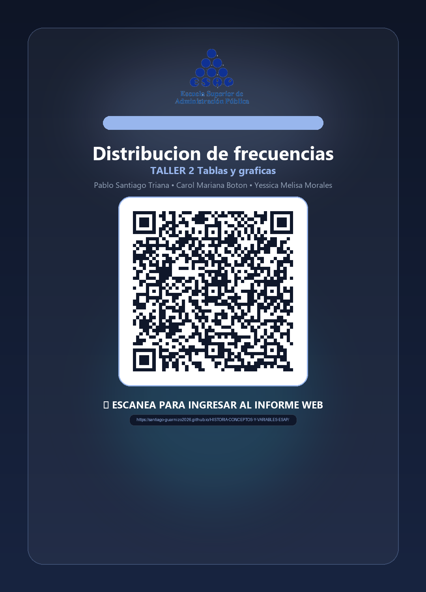

# Distribucion de frecuencias

**TALLER 2 Tablas y graficas • Escuela Superior de Administración Pública (ESAP)**

---

### 🌐 Página Web Interactiva (GitHub Pages)
👉 **[Ver Informe Interactivo en Línea](https://santiago-guarnizo2026.github.io/HISTORIA-CONCEPTOS-Y-VARIABLES-ESAP/)**

---

### 👥 Integrantes
* **Pablo Santiago Triana Guarnizo**
* **Carol Mariana Boton Soto**
* **Yessica Melisa Morales Soto**

---

### 📱 Código QR de Acceso
Escanea el siguiente código QR con la cámara de tu celular para acceder directamente a la página web del informe:

  

